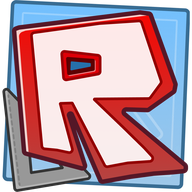

<p align="center"></p>

# RBLXStudio

Versão do Roblox Studio para celular (Android), feita em Kotlin + OpenGL ES.

## O que tem na v0.2
- Viewport 3D com Select / Move / Scale / Rotate, Undo / Redo, Copy / Paste / Duplicate
- **Play / Stop próprios**: personagem anda (joystick à esquerda), olha (arrastar à direita) e pula (botão); peças sem Anchored caem; Stop volta a cena ao que era
- Salvar / Abrir lugares (File), CanCollide, Focus (aba VIEW)
- Ícones vetoriais no lugar dos emojis e ícone do app (logo do Roblox Studio)
- **Login com conta do Roblox** (OAuth 2.0 + PKCE)

## Novidades da v0.15
- **Exportar**: File > Exportar lugar... (`.rbxl` binário ou `.rbxlx` XML) e Exportar modelo... (`.rbxm` ou `.rbxmx`). Modelo exporta o objeto selecionado; sem seleção, tudo do Workspace dentro de um Model. Vão peças (posição, rotação, tamanho, cor, Anchored, CanCollide, Transparency, MeshId/TextureID), scripts, Sounds, GUIs, Values, Tools e os serviços (StarterGui, ReplicatedStorage etc.). Itens sem equivalente (IntValue, ObjectValue) ficam de fora e o app avisa quantos.
- **Publicar no Roblox**: File > Publicar lugar no Roblox envia o lugar inteiro (XML) para um lugar que já existe na sua conta, pela Open Cloud (Place Publishing). Precisa de uma chave de API com a permissão `universe-places` (Write), o jogo na lista da chave e IP `0.0.0.0/0`. Dá para "Publicar" ou só "Salvar versão".
- **Enviar modelo ao Roblox**: File > Enviar modelo ao Roblox cria um asset Model na sua conta (chave com a permissão `assets` Write, e login feito no app).
- A chave de API fica guardada só no aparelho (pasta privada do app).

## Novidades da v0.14
- **Abrir mapas do Roblox**: Open File... agora lê `.rbxl` / `.rbxlx` (lugar inteiro) e `.rbxm` / `.rbxmx` (modelo, que é somado ao que já está aberto). Também aceita os nomes `.rblx` e `.rblxm`. Vêm as peças (posição, tamanho, rotação, cor, Anchored, CanCollide), scripts, Sounds, GUIs, Values e Tools. Modelos e pastas do Workspace viram peças soltas.
- **Open by Place ID / My Games** tentam baixar o mapa de verdade (funciona para lugares seus ou "copy unlocked", com o login feito). Se o Roblox negar, abre um Baseplate e avisa o motivo.
- **R6 e R15**: Game Settings > Avatar Rig Type (não mexe na qualidade gráfica). R15 tem 15 peças com cotovelo, joelho e pulso; roupas clássicas são fatiadas entre as peças.
- **Animações**: parado (respiração), andar, **pular**, cair, voar e Tool na mão, com transição suave, para R6 e R15.
- **Acessórios**: Red Pixel Heart e outros itens de "Front" / "Back" agora ficam no centro do peito/costas. O plano B 3D manda cabeçalhos de navegador, tenta sem e com login e o relatório do avatar mostra exatamente qual passo deu erro.
- Limite conhecido: malhas **versão 6/7** (formato novo do Roblox, comprimido) ainda não são lidas; esses itens dependem do plano B 3D.
- Limites do importador: terreno, Union/MeshPart como caixas, formas (Ball/Cylinder) viram blocos, arquivos com compressão ZSTD ainda não abrem, máximo de 30000 peças.

## Roadmap
- [x] v0.15: exportar .rbxl/.rbxm e publicar no Roblox (Open Cloud)
- [x] v0.14: importar .rbxl/.rbxm, mapas por Place ID, R6/R15, animações base e pulo
- [ ] Animações customizadas (KeyframeSequence / AnimationId, `Humanoid:LoadAnimation`) e mais animações R6/R15
- [ ] Malhas versão 6/7 (Draco) para todos os acessórios; roupas em camadas
- [ ] Mais recursos de script (boost estilo Sonic, voo, BodyVelocity, Raycast, TweenService)
- [ ] Barra de qualidade gráfica no estilo do Roblox
- [ ] Ícone do Empty Place mais fiel ao original
- [ ] Terreno, transparência, formas (esfera, cilindro, cunha) e suporte a ZSTD

## Novidades da v0.13
- Tela inicial no estilo do Roblox Studio: "Oi, nome" com sua foto, abas Home, Recent, My Games e Group Games (lugares da sua conta com o ícone de cada um; sem ícone aparece o globo verde), Open File... e Open by Place ID, engrenagem de configurações.
- Editor: joystick para voar com a câmera, botões de subir/descer, foco e velocidade x1/x2/x4. Editor de scripts novo em tela cheia, com abas, números de linha, cores de sintaxe, Check e fileira de símbolos.
- Tool e inventário: nova classe Tool (com Handle) no StarterPack, barra de Tools e mochila no Play, eventos Equipped / Unequipped / Activated, Humanoid:EquipTool.
- Gráficos: céu com gradiente, sol e nuvens, névoa, luz mais bonita, studs no Classic Baseplate, reflexo e sombra do personagem. Qualidade 1 a 10 ou Automática (menu do jogo > Settings e engrenagem da tela inicial).

## Novidades da v0.12
- Menu do jogo no estilo antigo do Roblox: abas People, Settings, Report, Help e Record; botões Leave, Reset Character e Resume embaixo.
- Ícone do botão de menu refeito (o PNG antigo era um quadrado branco).
- Filtro de palavrão no chat: a palavra vira ##### (português e inglês, aceita acento, letras repetidas e números no lugar de letras).
- Acessórios: o encaixe agora vem do Attachment do próprio item (posição e rotação certas) e a textura é escolhida pelo TextureID / ColorMap. Malhas versão 5 e malhas com ossos são lidas. Plano B 3D tenta o endereço novo sem cookie e depois o antigo.
- O relatório do avatar mostra o ponto de encaixe usado em cada acessório.

## Novidades da v0.10
- Morte estilo Roblox: as 6 peças se soltam, mantêm a velocidade do personagem, caem pela gravidade, tombam e deitam no chão (sem explosão). Cair no void só renasce.
- Todos os menus do Editor (login, inserir objeto, File, cor, salvar...) com visual novo no estilo do Editor; ícones coloridos no Explorer e no menu de inserir.
- Login: relatório completo do avatar (cada item, tipo e resultado), também em "Ver avatar" no menu da conta.
- Explorer: StarterPlayerScripts e StarterCharacterScripts dentro de StarterPlayer, serviço Chat, e novas classes Model, StringValue, NumberValue e BoolValue.
- Personagem com Torso, Left/Right Arm e Left/Right Leg para scripts.
- Sound: o ID agora é convertido no link do áudio pela API nova do Roblox.

## Novidades da v0.9
- Avatar: busca os itens por 3 caminhos (avatar v1, v2 e currently-wearing), carrega camisa, calça, camiseta, rosto, cabeça de malha e acessórios (malhas v2, v3 e v4). O aviso depois do login mostra o que foi carregado e o que falhou.
- Câmera: dá para olhar para cima, pinça para zoom (bem perto vira primeira pessoa) e opção "Primeira pessoa" no menu do jogo.
- Scripts: Humanoid.Fly / PlatformStand / FlySpeed / Jump / MoveDirection, HumanoidRootPart.Position / CFrame / Velocity, Part.CFrame, CFrame.new, Players.LocalPlayer:GetMouse() (Hit, Target, X, Y, Button1Down), UserInputService.InputBegan / InputEnded, Enum.*, Debris:AddItem, math.clamp / round / sign.

Exemplo (LocalScript):
```lua
local player = game.Players.LocalPlayer
local hum = player.Character.Humanoid
hum.Fly = true
hum.FlySpeed = 60
local mouse = player:GetMouse()
mouse.Button1Down:Connect(function()
  local p = Instance.new("Part")
  p.Position = mouse.Hit.Position + Vector3.new(0, 2, 0)
  p.Parent = workspace
  game:GetService("Debris"):AddItem(p, 5)
end)
```

## Novidades da v0.6
- **Avatar do jogador**: ao entrar com a conta, o personagem usa as cores do corpo, a **camisa, calça e camiseta clássicas** (2D) e os **acessórios 3D** (chapéus, cabelo, rosto, pescoço, ombro, frente, costas, cintura) que a conta está vestindo
- **Menu de pausa novo** (logo do Roblox ou botão Voltar): Retomar, Reiniciar personagem, Sair, e aba **Configurações**
- **Shift Lock** (botão de cadeado perto do pulo; liga/desliga nas configurações)
- **Câmera**: Seguir ou Clássica (com zoom em pinça)
- **Movimento**: Joystick, D-Pad ou Tocar para mover
- **Morte igual ao Roblox**: o personagem se despedaça em blocos e reaparece depois de 3 s (Reiniciar personagem faz o mesmo)

Acessórios: malhas v1 a v5 são lidas; versões 6/7 usam o plano B 3D (veja a v0.14).

## Configurar o login com Roblox
1. Abra https://create.roblox.com/dashboard/credentials (aba **OAuth 2.0 Apps**) e crie um app.
2. Em **Permissions** marque os escopos `openid` e `profile`.
3. Em **Redirect URLs** adicione: `rblxstudio://oauth`
4. No app, toque em **Entrar** (canto superior direito), cole o **Client ID** (e o **Client Secret**, se o app tiver) e toque em **Entrar**.

O app fica em modo privado (só você e até 10 usuários) enquanto não for enviado para revisão do Roblox.

## Build
O GitHub Actions gera o APK a cada push (`.github/workflows/build.yml`).
